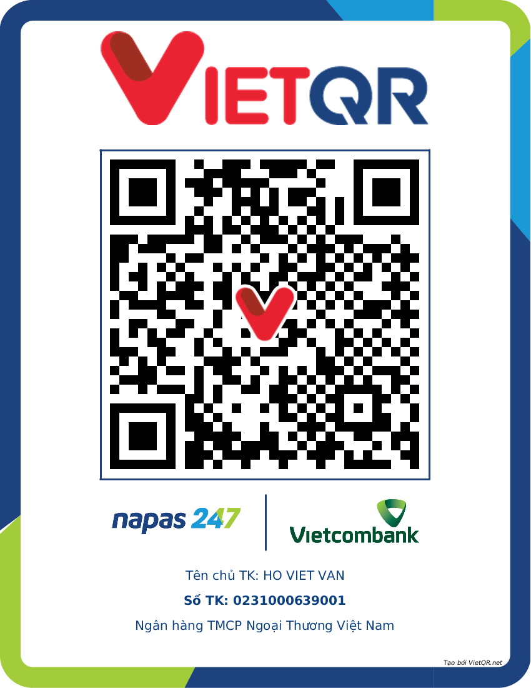

# Search Auto

Tiện ích mở rộng tự động tìm kiếm Bing và hoàn thành nhiệm vụ Microsoft Rewards hàng ngày.

> Dành cho Firefox: xem [hướng dẫn cho Firefox](docs/firefox.md).

---

## ⚠️ Lưu ý quan trọng (Đọc kỹ trước khi dùng)

- **Giới hạn 1 máy tối đa 6 tài khoản:** Mỗi máy **chỉ được chạy tối đa 6 tài khoản**. Mỗi tài khoản bắt buộc phải chạy trên một **Profile trình duyệt riêng biệt** (Profile 1, Profile 2,...). Chạy quá 6 tài khoản/máy hoặc đăng nhập chung profile sẽ bị Microsoft quét bất thường và khóa (ban) toàn bộ tài khoản Rewards.
- **Khoảng chờ an toàn (Delay):** Trong **Tùy chọn**, nên giữ khoảng nghỉ giữa 2 lần tìm kiếm từ **5 – 15 giây** trở lên. Tuyệt đối không chỉnh delay quá thấp để tránh bị phát hiện dùng bot hoặc bị phạt giam điểm (cooldown).
- **Trình duyệt khuyên dùng:** Nên dùng **Google Chrome**. Trên Microsoft Edge có thể bị hệ thống chặn tính năng tự động bấm làm nhiệm vụ Rewards.
- **Lịch tự động:** Tiện ích chỉ chạy được khi trình duyệt đang mở. Nếu tắt máy hoặc tắt trình duyệt vào giờ hẹn, hệ thống sẽ bỏ qua và không tự chạy bù.

---

## 🚀 Cài đặt nhanh

1. Mở `chrome://extensions` trên Chrome và bật **Chế độ dành cho nhà phát triển** (Developer mode).
2. Bấm **Tải tiện ích đã giải nén** (Load unpacked) rồi chọn thư mục project này, nơi có `manifest.json` ở gốc.
3. Ghim **Search Auto** lên thanh công cụ.
4. Mở Bing và Rewards đăng nhập tài khoản Microsoft trong profile đó.

---

## 📖 Cách sử dụng

- **Chạy ngay:** Mở popup. Popup hiện số lượt **Máy tính** và **Điện thoại** đã lưu. Bấm **Start**. Khi đang chạy, nút đổi thành **Dừng** và hiện tiến độ.
- **Đổi số lượt, khoảng nghỉ, chủ đề:** Bấm bánh răng **Tùy chọn**. Mẫu nhanh `11 · 0`, `21 · 11`, `31 · 21`, `51 · 31` nằm trong mục **Tìm kiếm**. Thay đổi được lưu tự động.
- **Chỉ làm nhiệm vụ:** Trong **Tùy chọn** → **Tùy chọn khác**, bấm **Chạy nhiệm vụ**.
- **Chạy theo lịch:** Trong **Tùy chọn** → **Lịch chạy**, chọn tần suất. Nút hiện **Chạy một lần** khi đang ở Thủ công, và **Đặt lịch** với các tần suất còn lại. Khi phiên đang chạy, nút đó hiện **Dừng**. Trình duyệt phải đang mở.

---

## 🛠️ Xử lý lỗi thường gặp

- **Không nhận điểm Mobile:** Trong **Tùy chọn**, bật **Tối ưu điểm Mobile** và **Giữ đăng nhập Rewards sau Mobile**. Đăng nhập lại Bing nếu chưa nhận.
- **Tiện ích bị treo hoặc dừng giữa chừng:** Bấm **Dừng** trên popup, rồi chạy lại. Log lỗi tải trong **Tùy chọn** → **Dữ liệu & nhật ký**.
- **Edge không tự bấm nhiệm vụ:** Làm thủ công trên tab Rewards đang mở, hoặc chuyển sang dùng Google Chrome để ổn định nhất.

---

## ☕ Ủng hộ tác giả

Nếu tiện ích hữu ích cho bạn, hãy
<a href="https://github.com/vanhobmt99/reward">tặng 1 sao trên GitHub</a>
hoặc ủng hộ tác giả qua:

<table align="center">
  <thead>
    <tr>
      <th align="center">Vietcombank</th>
      <th align="center">MoMo</th>
    </tr>
  </thead>
  <tbody>
    <tr>
      <td align="center">
         
        <strong>HO VIET VAN</strong> 
        <code>0231000639001</code>
      </td>
      <td align="center">
         
        <strong>HO VIET VAN</strong> 
        <code>0326363942</code>
      </td>
    </tr>
  </tbody>
</table>
